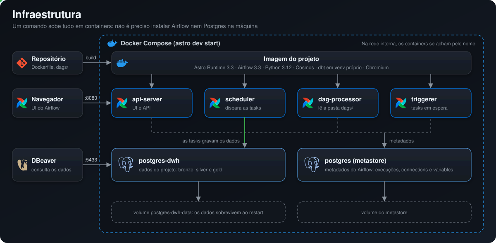
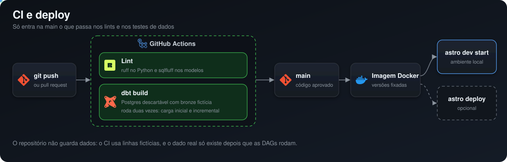

# Data Pipelines

[](https://github.com/lucxszs/data-pipelines/actions/workflows/ci.yml)
[](https://airflow.apache.org/)
[](https://www.python.org/)
[](https://www.getdbt.com/)
[](https://github.com/astronomer/astronomer-cosmos)
[](https://www.postgresql.org/)

Plataforma de dados em que o **Airflow** orquestra, o **dbt** transforma e o **Cosmos** liga
os dois. Qualquer fonte entra seguindo o mesmo padrão, e tudo sobe em containers com um único comando.

## Arquitetura



| Camada | Quem escreve | O que guarda |
|---|---|---|
| **Bronze** | Airflow | O dado como veio da fonte |
| **Silver** | dbt | Dado limpo e tipado |
| **Gold** | dbt | Tabelas prontas para análise |

**Materialização:** a silver é `incremental` quando a base acumula histórico, processando só
o que mudou desde a última carga. Quando a fonte entrega a base inteira a cada carga, e nos
agregados da gold, o modelo é `table`. As chaves dos modelos incrementais têm índice. Não há
particionamento porque o volume atual não justifica o custo de manutenção.

## Padrão dos pipelines



Uma única convenção liga cada fonte do início ao fim:

| Item | Convenção |
|---|---|
| DAG e arquivo | `{fonte}_load_{base}` |
| Código de extração | `dags/scripts/{fonte}/` com `client`, `domain` e `job` |
| Tabela bronze | `bronze.{fonte}_{base}` |
| Declaração da bronze | `models/sources/{fonte}_{base}.yml` |
| Modelos dbt | `models/{silver,gold}/{fonte}/`, com um `.sql` e um `.yml` por modelo |
| Seleção no Cosmos | `tag:{fonte}` |

**Decisões de projeto:**

- **Cargas idempotentes:** reexecutar uma DAG não duplica dados.
- **Uma task por modelo:** uma falha é reprocessada sozinha, com log próprio.
- **Testes como portão:** um teste que falha impede a camada seguinte de rodar.
- **Sem dados no repositório:** tudo vem das fontes quando as DAGs rodam.

### Como adicionar uma fonte

1. Crie `dags/scripts/{fonte}/` com o cliente, as constantes e o job de `extract` e `load_bronze`.
2. Declare a tabela bronze em `models/sources/{fonte}_{base}.yml`.
3. Crie os modelos em `models/silver/{fonte}/` e `models/gold/{fonte}/`, cada um com seu `.yml` de testes.
4. Adicione a tag da fonte em `dbt_project.yml`.
5. Crie `dags/{fonte}_load_{base}.py` copiando uma DAG existente e trocando a tag.

## Infraestrutura



| Serviço | Papel | Acesso pela máquina |
|---|---|---|
| `api-server` | UI e API do Airflow | `localhost:8080` |
| `scheduler` | Dispara e executa as tasks | |
| `dag-processor` | Lê os arquivos de DAG | |
| `triggerer` | Cuida de tasks em espera | |
| `postgres` | Metadados do Airflow | `127.0.0.1:5432` |
| `postgres-dwh` | Dados do projeto | `127.0.0.1:5433` |

Os dados ficam em um banco separado dos metadados do Airflow, então um não interfere no
outro. O dbt roda em um virtualenv próprio dentro da imagem, para que suas dependências
não entrem em conflito com as do Airflow.

## CI e deploy



A cada push e pull request, o [GitHub Actions](.github/workflows/ci.yml) roda três jobs:

- **ruff:** lint do código Python
- **sqlfluff:** lint dos modelos SQL
- **dbt:** `dbt build` duas vezes em um Postgres descartável, com dados fictícios, para testar a carga inicial e a incremental

**Deploy:** a unidade de deploy é a imagem Docker, com todas as versões fixadas. Hoje o
projeto roda localmente com o Astro CLI e não tem um ambiente de produção configurado.
Para publicar no Astro, o caminho é criar um Deployment e rodar `astro deploy`.

## Como rodar

Você precisa do Docker e do [Astro CLI](https://www.astronomer.io/docs/astro/cli/overview).

### Windows (PowerShell)

Instale o [Docker Desktop](https://www.docker.com/products/docker-desktop/) com WSL 2 e deixe-o aberto. Depois:

```powershell
winget install -e --id Astronomer.Astro
git clone https://github.com/lucxszs/data-pipelines.git
cd data-pipelines
astro dev start
```

### Linux

Instale o [Docker Engine](https://docs.docker.com/engine/install/). Depois:

```bash
curl -sSL install.astronomer.io | sudo bash -s
git clone https://github.com/lucxszs/data-pipelines.git
cd data-pipelines
astro dev start
```

### Acessos

| O quê | Onde |
|---|---|
| UI do Airflow | http://localhost:8080 |
| Banco de dados | `127.0.0.1:5433`, banco `dwh`, usuário e senha `postgres` |

A connection `postgres_dwh` já vem configurada, e as tabelas são criadas pelas próprias DAGs.

### Comandos do dia a dia

Estes comandos são iguais no Windows e no Linux:

| Comando | O que faz |
|---|---|
| `astro dev start` | Constrói a imagem e sobe os containers |
| `astro dev stop` | Para os containers e mantém os dados |
| `astro dev restart` | Reconstrói e reinicia, necessário ao mudar `Dockerfile` ou `requirements.txt` |
| `astro dev parse` | Valida as DAGs sem executá-las |
| `astro dev kill` | Remove containers e volumes, **apagando os dados locais** |

### Lint local

**Windows (PowerShell):**

```powershell
pip install ruff==0.17.4 sqlfluff==4.5.0
ruff check .
Push-Location dags\dbt\data_warehouse
sqlfluff lint models tests
Pop-Location
```

**Linux:**

```bash
pip install ruff==0.17.4 sqlfluff==4.5.0
ruff check .
(cd dags/dbt/data_warehouse && sqlfluff lint models tests)
```

## Observabilidade

Todos os scripts registram logs no mesmo formato:

```
• extract     │ Fetching records │ progress=100/500
⚠ extract     │ API overloaded, backing off │ status=503 · attempt=1/5 · wait=2s
✔ extract     │ Records saved │ rows=500
✔ load_bronze │ Rows upserted │ rows=500 · table=bronze.fonte_base
✖ alert       │ Task failed │ dag=fonte_load_base · task=extract
```

Quando uma task falha depois dos retries, o projeto também pode
[avisar no Telegram](docs/telegram-alerts.md). Esse alerta é opcional.

## Estrutura

```
dags/
├─ {fonte}_load_{base}.py     # definição das DAGs
├─ dbt/data_warehouse/        # projeto dbt
│  ├─ models/
│  │  ├─ sources/             # um yml por tabela bronze
│  │  ├─ silver/{fonte}/
│  │  └─ gold/{fonte}/
│  ├─ macros/
│  └─ tests/
├─ domain/                    # defaults das DAGs, connections e config do Cosmos
├─ scripts/{fonte}/           # client, domain e job de cada fonte
└─ utils/                     # helpers de Postgres, Playwright, logs e Telegram
docs/                         # diagramas e guia de alertas
include/                      # arquivos temporários das execuções (fora do Git)
.github/                      # CI e dados fictícios para os testes
```
